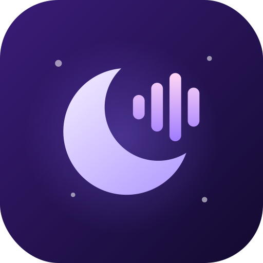

<div align="center">



# Nocturne

**Музичний плеєр для Android і Windows, який грає з YouTube Music, Spotify і SoundCloud**

Material You 3 на Android · Mica / Acrylic на Windows 11 · одна кодова база на Kotlin Multiplatform


</div>

---

## Що вміє

### Джерела музики

У кожного треку, альбому чи плейлиста є значок, звідки його взято.

| | Джерело | Що доступно | Звідки йде звук |
|---|---|---|---|
| 🔴 | **YouTube Music** | головна стрічка, пошук (треки, альбоми, плейлисти, артисти), радіо / «далі грає», підказки пошуку | YouTube |
| 🟢 | **Spotify** | пошук, альбоми, плейлисти, артисти, нові релізи | трек автоматично шукається на YouTube Music (за назвою, артистом і тривалістю) |
| 🟠 | **SoundCloud** | пошук, треки, сети, артисти, чарти | SoundCloud (прямі потоки або HLS) |

Можна шукати в одному джерелі або в усіх одразу. Посилання `music.youtube.com`, `youtube.com`, `open.spotify.com` і `soundcloud.com` можна вставити прямо в пошук, а на Android — відкрити або «поділитися» ними в Nocturne.

### Плеєр
- Міні-плеєр і повноекранний плеєр, як у Metrolist: його можна розгорнути свайпом угору і закрити свайпом униз; свайп по обкладинці перемикає трек
- Тема плеєра підлаштовується під кольори обкладинки; фон на вибір: градієнт, розмита обкладинка або однотонний
- **Синхронізований текст пісні** з [LRCLIB](https://lrclib.net): автопрокрутка, перехід до рядка по тапу, налаштування розміру й вирівнювання
- Черга: «грати наступним», «додати в чергу», видалення треків, перемішування, повтор (усіх або одного)
- **Автоплей / радіо**: коли черга закінчується, додаються схожі треки
- **Таймер сну**: від 5 до 90 хвилин або до кінця треку
- Запам'ятовує чергу між запусками, за бажанням продовжує відтворення одразу після запуску
- На Android: фонове відтворення, нотифікація з медіакнопками, керування з гарнітури й Bluetooth, кеш аудіо, пропуск тиші

### Бібліотека
- Вподобані треки, власні плейлисти (створення, перейменування, видалення), збережені альбоми, плейлисти й артисти
- Історія прослуховувань, розділи «Слухати знову» і «Твої топ-треки» на головній
- Історія пошуку

### Налаштування
- **Мова інтерфейсу**: українська, англійська, польська, чеська, німецька, французька, іспанська, італійська, португальська, турецька, японська, корейська, китайська
- **Оформлення**: світла / темна / як у системі, Material You (Android 12+) або акцентний колір Windows, 10 готових акцентів, AMOLED-чорна тема, стиль плеєра, значки джерел, компактні списки, ефект вікна на Windows (Mica / Mica Alt / Acrylic / вимкнено)
- **Контент**: увімкнення й вимкнення джерел, джерело пошуку за замовчуванням, мова й країна контенту, приховування explicit, підказки пошуку
- **Плеєр**: якість аудіо (низька / нормальна / висока), автоплей, запам'ятовування черги, відтворення після запуску, крок перемотки, зупинка після закриття застосунку (Android)
- **Текст пісні**, **Spotify API**, **сховище** (розмір кешу, очищення історії), **приватність** (пауза історії прослуховувань і пошуку)

### Windows
- Напівпрозоре вікно з ефектом **Mica / Acrylic** через DWM у стилі Windows 11, темний заголовок, заокруглені кути
- Акцентний колір береться із системи
- **Discord Rich Presence**: у профілі видно, що й де ти слухаєш (обкладинка, значок джерела, час, кнопка «Слухати»). Усі рядки налаштовуються шаблонами `{title}` `{artist}` `{album}` `{source}` `{app}` з живим превʼю.. Працює одразу — достатньо, щоб Discord був запущений; свій Application ID можна вказати в **Налаштування → Discord**
- ПКМ по треку відкриває його меню
- Глобальні гарячі клавіші (працюють і коли вікно згорнуте) та плаваючий міні-плеєр поверх усіх вікон
- Адаптивний макет: бокова навігація й нижня панель плеєра з гучністю
- Гарячі клавіші:

| Клавіші | Дія |
|---|---|
| `Ctrl` + `Space` | відтворення / пауза |
| `Ctrl` + `→` / `←` | наступний / попередній трек |
| `Ctrl` + `Shift` + `→` / `←` | перемотка вперед / назад |
| Медіаклавіші | працюють |
| `Esc` | назад |

---

## Встановлення

Готові збірки лежать у [**Releases**](https://github.com/lenny-akumu/nocturne/releases) і в артефактах кожного запуску [**Actions**](https://github.com/lenny-akumu/nocturne/actions):

- **Android**: `Nocturne-android.apk` (Android 8.0+)
- **Windows**: `Nocturne-Setup-*.exe` — оновлення ставляться поверх, старі копії прибираються автоматично

> **Windows:** аудіодвижок (libVLC) вже вбудований в інсталятор, нічого додатково ставити не треба.

- **Linux** (x86_64): одна команда в терміналі — завантажить останню версію, за потреби поставить VLC, додасть Nocturne у меню застосунків і команду `nocturne`:

```sh
curl -fsSL https://raw.githubusercontent.com/Lenny-Akumu/Nocturne/main/install.sh | sh
```

Видалити: `curl -fsSL https://raw.githubusercontent.com/Lenny-Akumu/Nocturne/main/install.sh | sh -s -- --uninstall`. Оновлення з самого застосунку теж працюють.

### Акаунти
**Налаштування → Accounts** — вхід, щоб підтягнути вподобані треки, плейлисти, альбоми й артистів:

- **YouTube Music** — «Sign in with Google» (Android) або вставка cookies з браузера (Windows).
- **SoundCloud** — вхід у вбудованому браузері (Android) або вставка `oauth_token`.
- **Spotify** — створи застосунок на [developer.spotify.com/dashboard](https://developer.spotify.com/dashboard), додай Redirect URI `nocturne://spotify-callback` (Android, iOS) і `http://127.0.0.1:43821/callback` (Windows), у «User Management» додай email свого акаунта Spotify, встав **Client ID** у Налаштування → Акаунти → Spotify (або в `BuildInfo.SPOTIFY_CLIENT_ID`) і натисни «Continue with Spotify». Вхід через PKCE — Client Secret не потрібен.

---

## Збірка з вихідного коду

Потрібні **JDK 17+**, а для Android ще **Android SDK** (compileSdk 36).

```bash
# Android APK
./gradlew :composeApp:assembleRelease

# Запустити десктоп-версію
./gradlew :composeApp:run

# Інсталятори для Windows (запускати на Windows)
./gradlew :composeApp:packageMsi :composeApp:packageExe
```

Щоб підписати APK власним ключем, задай змінні середовища `NOCTURNE_KEYSTORE`, `NOCTURNE_KEYSTORE_PASSWORD`, `NOCTURNE_KEY_ALIAS` і `NOCTURNE_KEY_PASSWORD`. Без них використовується debug-ключ.

Для CI додай у **Settings → Secrets and variables → Actions** секрети `NOCTURNE_KEYSTORE_BASE64` (вміст `.jks` у base64), `NOCTURNE_KEYSTORE_PASSWORD`, `NOCTURNE_KEY_ALIAS` і `NOCTURNE_KEY_PASSWORD`. Без них кожна збірка підписується новим тимчасовим ключем, і нова версія не встановиться поверх старої.

Версія задається в `composeApp/src/commonMain/kotlin/app/nocturne/BuildInfo.kt`. Реліз: **Actions → Build → Run workflow** з галочкою *release*, або пуш тегу `v<версія>`. Застосунок сам перевіряє нові релізи й пропонує оновитись.

## Архітектура

```
composeApp/src/
├── commonMain/      спільний UI (Compose + Material 3), моделі, черга плеєра,
│                    InnerTube (YouTube Music), Spotify Web API, LRCLIB, бібліотека
├── jvmShared/       код для Android і десктопа: NewPipe Extractor (потоки YouTube / SoundCloud), файлове сховище
├── androidMain/     Media3 ExoPlayer + MediaSessionService, Material You, кеш
└── desktopMain/     вбудований libVLC (vlcj), Mica / Acrylic через DWM (JNA), акцентний колір Windows
```

| Шар | Технології |
|---|---|
| UI | Compose Multiplatform, Material 3, MaterialKolor, Coil 3 |
| Мережа | Ktor, OkHttp, kotlinx.serialization |
| Потоки | NewPipe Extractor |
| Відтворення | Media3 ExoPlayer (Android), libVLC через vlcj (Windows) |

## Подяки
[Metrolist](https://github.com/mostafaalagamy/Metrolist), [NewPipe Extractor](https://github.com/TeamNewPipe/NewPipeExtractor), [LRCLIB](https://lrclib.net), [MaterialKolor](https://github.com/jordond/MaterialKolor), шрифт [Monocraft](https://github.com/IdreesInc/Monocraft) (SIL OFL 1.1).

## Дисклеймер
Nocturne — неофіційний клієнт, не пов'язаний з YouTube, Google, Spotify чи SoundCloud. Усі торгові марки належать їхнім власникам. Користуйся відповідно до умов сервісів і законів своєї країни.
